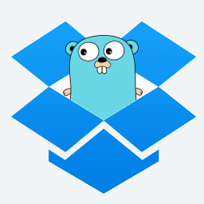

# dboxpaper

[](https://github.com/mattn/dboxpaper/actions?workflow=test)
[](https://goreportcard.com/report/github.com/mattn/dboxpaper)



client for Dropbox Paper

## Usage

```
$ dboxpaper help
```

Dropbox has migrated Paper docs to `.paper` files stored in Dropbox ("Paper as
files"). For such accounts, `list` shows the paths of `.paper` files, and the
other commands accept a path (starting with `/`) or a file ID (starting with
`id:`) instead of a doc ID. Docs of accounts not migrated yet are handled with
doc IDs as before.

list papers

```
$ dboxpaper list
/Migrated Paper Docs/memo.paper
/todo.paper
```

Use `--title` to show titles, `--json` to show metadata as JSON, and `--files`
to list `.paper` files even if the account is not detected as migrated.

cat paper

```
$ dboxpaper cat /todo.paper
$ dboxpaper cat XXXXXXXXXXX
```

upload paper (creates the file if it does not exist, otherwise overwrites it)

```
$ cat README.md | dboxpaper upload /README.paper
```

upload paper as a legacy doc / update a legacy doc

```
$ cat README.md | dboxpaper upload
$ cat README.md | dboxpaper upload XXXXXXXXXXX
```

delete paper (`.paper` files are moved to trash, legacy docs are deleted permanently)

```
$ dboxpaper delete /todo.paper
$ dboxpaper delete XXXXXXXXXXX
```

## Installation

```
$ go install github.com/mattn/dboxpaper@latest
```

## License

MIT

## Author

Yasuhiro Matsumoto (a.k.a. mattn)
